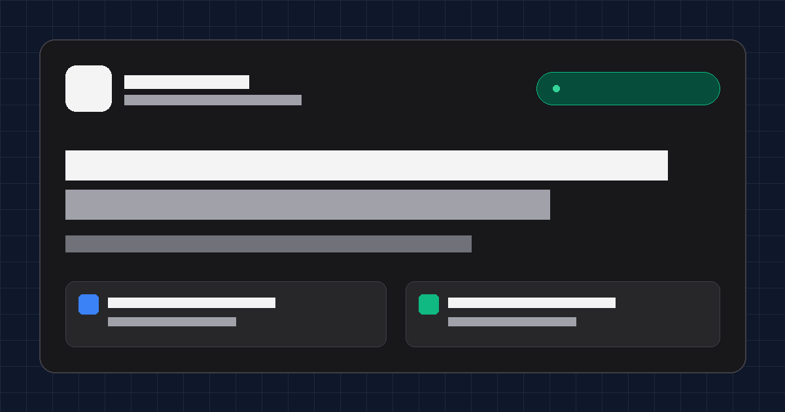

# Firas Ezra — UI/UX & Product Designer Portfolio

> High-performance personal portfolio and UX case study showcase built for tech recruitment and design engineering applications.



[-black?logo=next.js)](https://nextjs.org/)
[](https://react.dev/)
[](https://www.typescriptlang.org/)
[](https://tailwindcss.com/)
[](https://ui.shadcn.com/)
[](https://supabase.com/)
[](https://vercel.com/)

---

## 📌 Overview

This repository powers the personal portfolio website of **Firas Ezra**, a **Product & UI/UX Designer** with strong front-end engineering expertise (Master of Information Systems Management at Binus University; former UI/UX Designer at **Kadence International**).

Unlike typical static portfolio builders (Framer, Webflow, or Notion), this website is custom-engineered using **Next.js 15 (App Router)** and **Supabase (PostgreSQL)** to demonstrate design craftsmanship, technical feasibility, and high performance.

---

## ✨ Key Features

1. **Recruiter-Focused Hero & Value Proposition:**  
   Instant definition of professional specialty, credentials (Kadence Intern, Binus Magister), and 1-click **ATS-friendly PDF Resume Download**.
2. **Deep-Dive UX Case Study Engine (`/projects/[slug]`):**  
   Pre-rendered using **Static Site Generation (SSG)** featuring measurable business outcomes, qualitative research insights, and high-resolution WebP mockups:
   - **Kadence International:** Market research operations portal redesign (+38% workflow efficiency, SUS raised to 84.5).
   - **SAMPERIN:** Campus peer-to-peer errand logistics mobile app (89.2% task completion rate, 42s checkout).
3. **Interactive Contact & Lead Capture Form:**  
   Built with **Next.js Server Actions** and **Zod validation**, connected directly to Supabase with anti-spam honeypot protection and Sonner toast notifications.
4. **Lightweight Atomic View Counter:**  
   Tracks readership per case study using PostgreSQL RPC functions (`increment_project_view`) in an asynchronous, non-blocking client component.
5. **Modern Design System & Poppins Typography:**  
   Tailwind CSS v4 theme with semantic dark-mode palette, subtle grid accents, and **100% Poppins Google Font** typography.
6. **Built-in SEO & OpenGraph:**  
   Pre-configured OpenGraph preview cards (for LinkedIn, WhatsApp, and Twitter/X), dynamic `sitemap.xml`, and `robots.txt`.

---

## 🛠️ Tech Stack

| Layer | Technology |
| :--- | :--- |
| **Framework** | Next.js 15 (App Router, Turbopack) |
| **Language** | TypeScript (Strict type checking) |
| **Styling & Tokens** | Tailwind CSS v4, `@tailwindcss/turbopack` |
| **Component Primitives** | shadcn/ui (`Button`, `Card`, `Badge`, `Input`, `Textarea`, `Sonner`) |
| **Icons & Typography** | Lucide React, Google Font Poppins |
| **Backend Logic** | Next.js Server Actions (Zero dedicated server needed) |
| **Validation** | Zod v4 |
| **Database & Analytics** | Supabase (PostgreSQL with Row Level Security in Singapore) |
| **Hosting & Edge CDN** | Vercel (Hobby Tier — Rp 0 / month) |

---

## ⚡ Performance Benchmarks

* **Time to First Byte (TTFB):** `~135 ms`
* **DOM Interactive:** `~327 ms`
* **Full Page Load Event:** `< 550 ms`
* **Cumulative Layout Shift (CLS):** `0.00` (zero layout shifts)
* **Accessibility (WCAG AA):** 100% compliant (descriptive alt tags & accessible form labels)

---

## 📁 Directory Structure

```text
├── app/
│   ├── actions/
│   │   ├── contact.ts              # Server Action: Zod validation + Supabase insert
│   │   └── analytics.ts            # Server Action: Supabase view counter increment
│   ├── projects/
│   │   └── [slug]/
│   │       └── page.tsx            # Dynamic SSG case study detail page
│   ├── globals.css                 # Tailwind v4 theme tokens & Poppins mapping
│   ├── layout.tsx                  # Root layout, Poppins font, Navbar, Footer, Toaster
│   ├── page.tsx                    # Landing: Hero, FeaturedProjects, Experience, Contact
│   ├── robots.ts                   # Robots.txt generator
│   └── sitemap.ts                  # Sitemap.xml generator
├── components/
│   ├── case-study/                 # CaseStudyHeader, ImpactMetrics, ProblemSolution, Gallery
│   ├── layout/                     # Navbar, Footer
│   ├── sections/                   # HeroSection, FeaturedProjects, ProjectCard, Experience, ContactForm
│   └── ui/                         # shadcn/ui primitives (badge, button, card, input, textarea, sonner)
├── content/
│   └── projects/                   # Local static case study data (kadence-portal.ts, samperin-app.ts)
├── lib/
│   ├── supabase.ts                 # Supabase client singleton with fallback mode
│   ├── utils.ts                    # cn helper (clsx + tailwind-merge)
│   └── validations.ts              # Zod validation schema
├── public/
│   ├── documents/firas-cv.pdf      # ATS-friendly resume file
│   ├── images/projects/            # Optimized WebP mockup assets
│   └── og-image.png                # OpenGraph card for social sharing
├── supabase/
│   └── migrations/                 # PostgreSQL schema & RLS policies
└── types/
    └── case-study.ts               # Shared TypeScript interfaces
```

---

## 🚀 Getting Started

### 1. Prerequisites
- **Node.js** v20+ or v24+
- **npm** or **pnpm** / **yarn**

### 2. Clone and Install Dependencies
```bash
git clone https://github.com/<your-username>/portfolio.git
cd portfolio
npm install
```

### 3. Setup Environment Variables
Create a `.env.local` file in the root directory (refer to `.env.example`):
```bash
cp .env.example .env.local
```

Fill in your Supabase project credentials:
```env
NEXT_PUBLIC_SUPABASE_URL=https://your-project-id.supabase.co
NEXT_PUBLIC_SUPABASE_ANON_KEY=your-anon-key-here
NEXT_PUBLIC_SITE_URL=http://localhost:3000
```
> **Note:** If you haven't linked Supabase yet, the project includes an automated **development fallback mode** so you can develop and test the contact form and analytics locally without errors!

### 4. Database Setup (Supabase)
Run the migration script located at:
`supabase/migrations/20261022000000_create_portfolio_tables.sql`
inside your Supabase **SQL Editor**. This will:
1. Create `public.contact_messages` with `anon` INSERT-only RLS policy.
2. Create `public.project_views` with public SELECT RLS policy.
3. Create the `increment_project_view(text)` PostgreSQL RPC function.

To verify your connection, run:
```bash
node scripts/test-supabase.mjs
```

### 5. Run Development Server
```bash
npm run dev
```
Open [http://localhost:3000](http://localhost:3000) in your browser.

---

## 🧪 Build and Quality Checks

```bash
# Type-check TypeScript strictly
npx tsc --noEmit

# Run ESLint check
npm run lint

# Build optimized production bundle
npm run build

# Start production server locally
npm run start
```

---

## 🚢 Deployment to Vercel

1. Push your repository to **GitHub**.
2. Go to [Vercel](https://vercel.com/) and click **Add New...** > **Project**.
3. Import this repository.
4. Add the following Environment Variables in Vercel:
   - `NEXT_PUBLIC_SUPABASE_URL`
   - `NEXT_PUBLIC_SUPABASE_ANON_KEY`
   - `NEXT_PUBLIC_SITE_URL` (e.g. `https://firasezra.com` or `https://firas-portfolio.vercel.app`)
5. Click **Deploy**.

---

## 👤 Author

**Firas Ezra**
- **Role:** UI/UX Designer & Product Thinker (with Front-End Engineering competence)
- **Education:** Master of Information Systems Management (Binus University)
- **Email:** [firasezraep@gmail.com](mailto:firasezraep@gmail.com)
- **LinkedIn:** [linkedin.com/in/firasezra](https://linkedin.com)
- **Location:** Jakarta, Indonesia (GMT+7)

---

## 📄 License
This project is open-source and available under the [MIT License](LICENSE).
